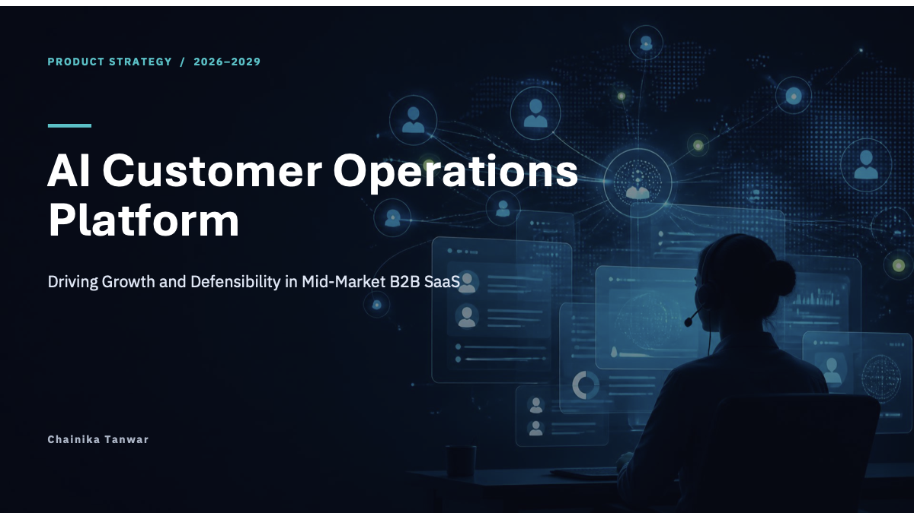

# AI Customer Operations Platform

**B2B product strategy, 2026–2029** · [← All case studies](../)

## Problem

Mid-market B2B SaaS support teams resolve one customer issue by hopping between the helpdesk, CRM, billing system, product admin tools and engineering trackers. Chatbots, routing and summarisation are already well served by incumbents (Salesforce, Zendesk, Freshworks, Fin). The unsolved part starts after the AI understands the question: doing the cross-system work to fix it.

## Approach

- **Target customer:** B2B SaaS companies with 200–1,000 employees, 20–100 support agents and 10,000+ interactions a month. Explains why startups and enterprises are the wrong first segment.
- **Market evidence:** CRM market sizing, AI adoption in service, AI revenue benchmarks from incumbents, and the ROI gap (only 24% of leaders show positive AI returns).
- **Positioning:** "Keep your existing helpdesk and CRM. We make the operation running across them intelligent."
- **Land and expand:** land with an AI Resolution Copilot (humans in control), then expand to automated resolution, AI quality and support intelligence, proactive operations, and other teams (Customer Success, Product, Engineering, Finance).
- **Defensibility:** resolution data flywheel, a Customer Operations Graph built on deep read/write integrations, workflow and policy memory, and trust and governance controls.
- **Metrics:** North Star is Successful Automated Resolution Rate, with outcome metrics (MTTR, cost per resolution, CSAT) and guardrails (rollback rate, policy violations).
- **Roadmap:** three horizons (Land, Expand, Platform) with expansion triggers tied to observed signals.

## Files

| File | Description |
|---|---|
| [strategy-deck.pdf](strategy-deck.pdf) | 15-slide strategy presentation |
| [strategy-document.docx](strategy-document.docx) | Full written strategy with references |
