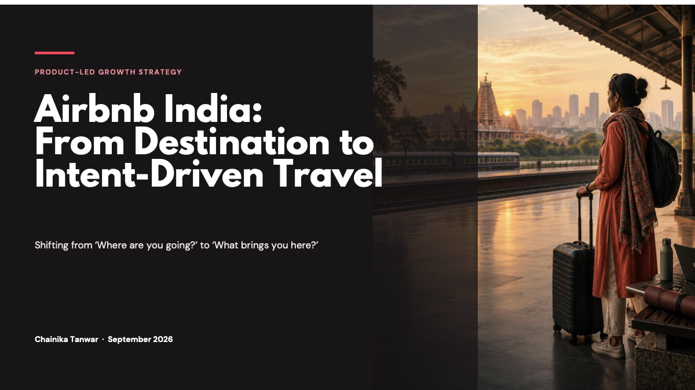

# Airbnb India: From Destination to Intent-Driven Travel

**Product-led growth strategy** · [← All case studies](../)

## Problem

91% of Airbnb's guests in India in 2024 were domestic travellers. Search still starts with "Where are you going?", which treats every trip as generic leisure. High-intent trips such as medical stays, pilgrimages, remote work and business travel have needs a destination-first search can't show.

## Approach

- **Thesis:** shift from "Where are you going?" to "What brings you here?" and organise discovery around travel intent.
- **Four segments and their jobs to be done:** medical traveller or caregiver, pilgrimage traveller, remote worker, and business/bleisure traveller.
- **Cross-functional PLG:** one intent signal shared by Product, Marketing, Operations, Support, Partnerships and Host Growth.
- **Six growth loops** and an integrated flywheel (better intent data → better matching → better supply → higher trust → repeat and referral).
- **Five MVPs**, each with hypotheses, a cheap prototype, success metrics and guardrails: Purpose-Based Discovery, Care Stays, Spiritual Journey Planner, Work-Ready Airbnb, Work-to-Bleisure Extension.
- **Revenue model for India:** long-stay economics, a services marketplace, Experiences, Airbnb for Work Pro, bleisure extensions and a later Airbnb Pass test.
- **Measurement and rollout:** North Star is GBV per Active Traveller per Year, an AARRR framework, a 12-month rollout and a risk register.

## Files

| File | Description |
|---|---|
| [plg-strategy-deck.pdf](plg-strategy-deck.pdf) | 17-slide strategy presentation |
| [plg-strategy-document.docx](plg-strategy-document.docx) | Full written strategy with MVP details and references |
