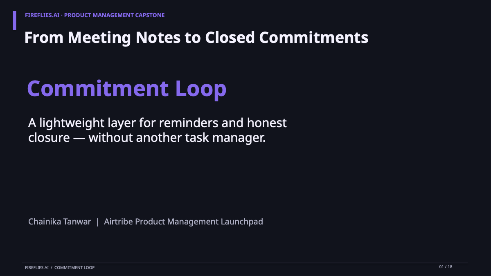

# Fireflies.ai: From Meeting Notes to Closed Commitments

**Capstone: research to prototype** · [← All case studies](../)

**[Try the interactive prototype →](https://bot-roman-55048301.figma.site)**

## Problem

Fireflies.ai captures meetings and extracts action items, but only 28% of extracted commitments reach an explicit outcome within 14 days (a baseline assumed in the capstone brief). Capture is already solved across the market. Closure is not.

## Approach

**Research**
- 16 semi-structured interviews with people who make commitments, people who depend on them, and people who judge tools. The sample is mostly engineering.
- Seven research questions trace a commitment from the meeting to its real outcome.
- The interviews disproved my first hypothesis. Ownership is usually clear. The real barrier is that follow-up depends on someone chasing, and drops or "no change needed" outcomes go unrecorded.
- Secondary research (Microsoft, Atlassian and Asana surveys, plus behavioural studies), a hands-on teardown of Fireflies, and a competitive analysis of Otter, Read AI, Granola, MeetGeek, Zoom, Teams and Google Meet.

**Solution: Commitment Loop**
- 15 ideas scored with RICE. Two V1 bets were chosen:
  - **Honest status options (RICE 162):** Done, In Progress, No Change Needed, Dropped and Reassign, instead of checkbox or delete.
  - **Private commitment reminders (RICE 65):** batched and capped, with snooze and mute, and no manager escalation.
- Mini PRDs, a status model with resolution rules, six wireframes and an interactive Figma prototype.
- Principle: *automate remembering, not deciding.*

**Adoption, metrics and risk**
- Start with engineering teams, then expand to adjacent teams and other functions, with cohort rollout gates.
- **North Star:** 14-day honest commitment resolution, from 28% to 45% in six months. Supporting, business and guardrail metrics, plus an event-tracking spec.
- Risk register, trade-offs, non-goals, and a V1–V4 roadmap.

## Files

| File | Description |
|---|---|
| [capstone-presentation.pdf](capstone-presentation.pdf) | 34-slide presentation |
| [supporting-artifacts.pdf](supporting-artifacts.pdf) | Full 51-page case study: interview tracker, teardown, competitive analysis, PRDs, wireframes, metrics and risks |

Interviewees are anonymised as P1–P16, and interview and recruitment screenshots have been removed.
