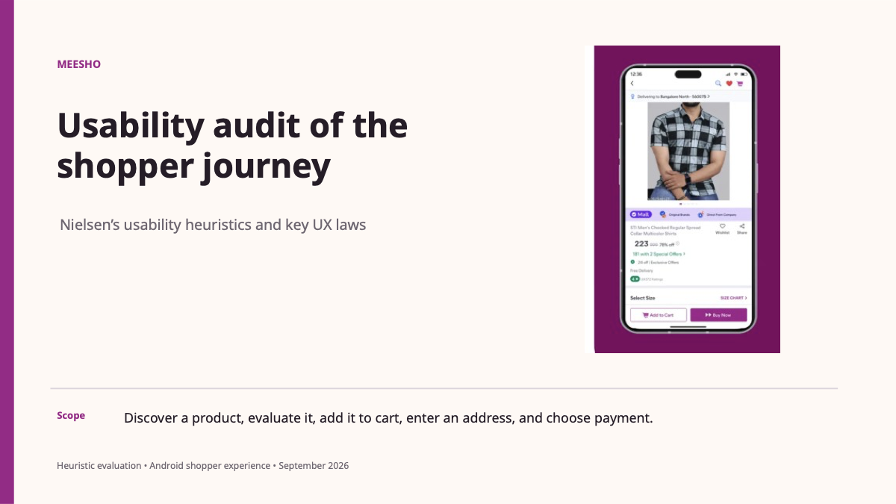

# Meesho: Usability Audit of the Shopper Journey

**UX heuristic evaluation** · [← All case studies](../)

## Problem

Can a price-conscious shopper on the Meesho Android app understand where they are, narrow a large catalogue, judge product quality, avoid mistakes and check out with confidence?

## Approach

An expert review of the full flow (discover → search → evaluate → cart and address → pay) using **Nielsen's usability heuristics** and UX laws (Hick's, Jakob's, Fitts's, Von Restorff).

**Seven findings, rated by severity**, including:
- A crowded first screen and overlapping category routes.
- Weak visibility of applied filters.
- "Add to Cart" and "Buy Now" given equal weight before size is resolved.
- A size selector that is easy to miss.
- Trust evidence scattered across the product page.
- An ambiguous payable total at checkout (COD vs. online price).

**Four redesign concepts:** a simplified home, visible filter state, a safer product decision screen and a clear payable total.

## Files

| File | Description |
|---|---|
| [usability-audit.pdf](usability-audit.pdf) | 7-slide audit with annotated screens and redesign concepts |
