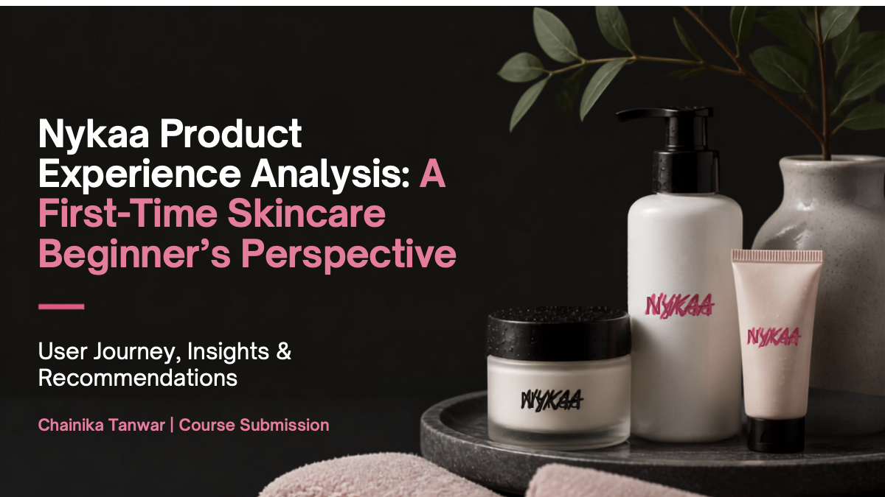

# Nykaa: A First-Time Skincare Beginner's Perspective

**Product walkthrough and user research** · [← All case studies](../)

## Problem

How well does Nykaa serve first-time, low-knowledge skincare shoppers across discovery, confidence, friction and drop-off risk?

## Approach

- **Method:** self-observation of an 11-step journey plus two user interviews.
- **Journey audit:** what works (onboarding, educational search and AI guidance, clear ingredient information, Buy in Store, Wellness content) and what slows users down (pop-ups, a crowded home page, review filters that need a profile, a slow virtual try-on, an app crash during Offers).
- **Drop-off risks** rated by severity at high-intent moments.
- **Synthesis:** education sets Nykaa apart but is spread across too many places, trust must hold from discovery through delivery and support, and personalisation should start simple and grow.
- **Recommendation:** an optional, beginner-friendly **Guided Mode**: a skin quiz, curated beginner kits, step-by-step guidance and expert chat.

## Files

| File | Description |
|---|---|
| [product-walkthrough.pdf](product-walkthrough.pdf) | 9-slide walkthrough, findings and recommendation |
