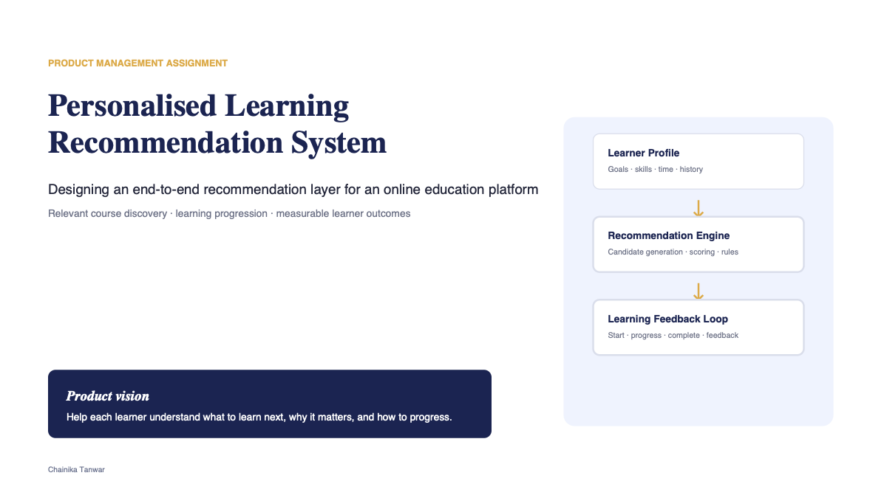

# Personalised Learning Recommendation System

**Product system design** · [← All case studies](../)

## Problem

Learners on an online education platform don't know what to learn next or why. The brief: design a recommendation layer on top of the existing course, enrolment and progress systems to lift engagement by 25%, completion by 30% and satisfaction by 20%.

## Approach

- **Personas:** three learner types (career switcher, upskiller, job seeker), two instructor types and a platform admin.
- **User stories** for every persona.
- **Functional requirements** with priorities: personalised onboarding, ranking, recommendation explanations, learning paths, feedback, adaptive next steps, instructor insights, admin analytics and experimentation.
- **Non-functional requirements:** performance (P95 under 2s), scalability, 99.9% availability with fallback, compliance, security, monitoring and extensibility.
- **System design:** end-to-end architecture and a six-step recommendation pipeline (candidate generation → scoring → rules → explain → learn from outcomes).
- **Trade-off:** personalisation vs. privacy. Start with explicit, minimum-necessary signals and add behavioural data only when experiments show value.
- **Assumptions and a four-phase roadmap**, from a rule-based MVP to an ML ranker and an AI learning coach, each tied to the business goals.

## Files

| File | Description |
|---|---|
| [system-design.pdf](system-design.pdf) | 13-page product and system design |
