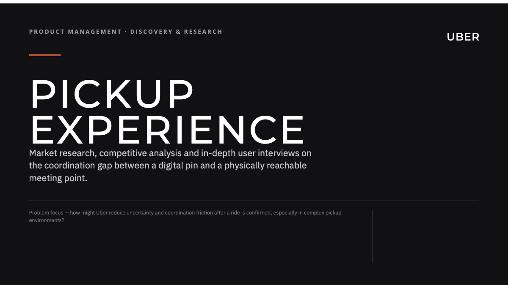

# Uber Pickup Experience

**Discovery and user research** · [← All case studies](../)

## Problem

How might Uber reduce uncertainty and coordination friction after a ride is confirmed, especially at stations, gated colonies, crowded markets and office parks?

## Approach

**Step 1: Market research and competitive analysis**
- India ride-hailing market context and demand segments ranked by pickup friction.
- Competitive landscape: Ola, Rapido, and informal alternatives (calls and landmarks, street hail, walking to the main road).
- Constraints: designated airport and station zones, curb and no-stopping rules, one-ways and dividers, data privacy, safety and state aggregator regulation.

**Step 2: In-depth user interviews (n=9)**
- Interview findings, cross-interview synthesis and six thematic insights.
- 8 of 9 riders had moved from their original pin, 7 of 9 had a pickup-stage cancellation, and calls and messages were the universal fallback.
- Five behavioural personas, five jobs to be done, and six opportunity areas with the hypothesis and evidence needed for each.
- Next steps: driver interviews, internal funnel data, low-fidelity concept tests and explicit safety guardrails.

**Product principle:** optimise for the best shared pickup outcome, not the closest point, the shortest rider walk or the shortest driver route alone.

## Files

| File | Description |
|---|---|
| [discovery-research.pdf](discovery-research.pdf) | 15-page research report (interviewees anonymised as P1–P9) |
