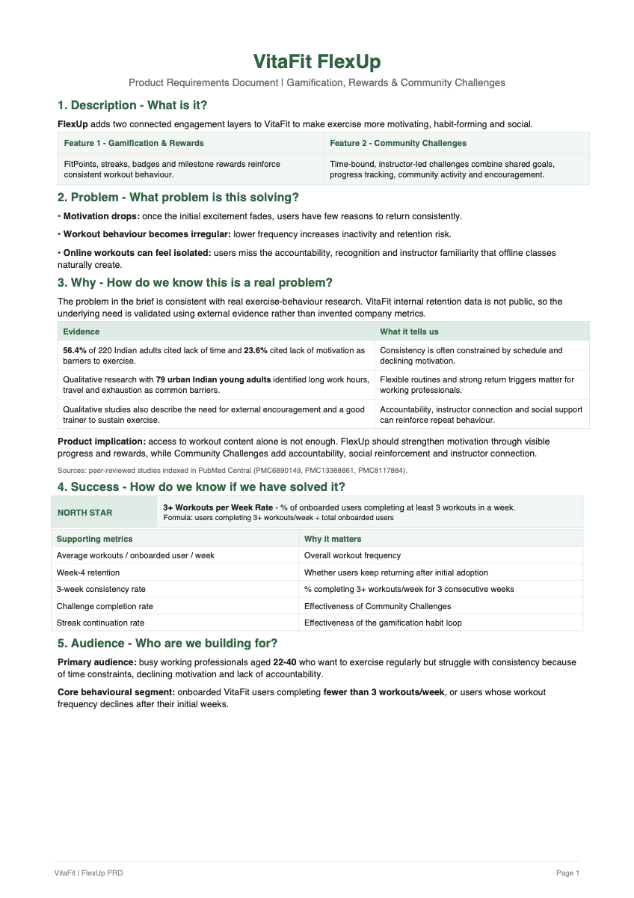

# VitaFit FlexUp

**PRD and wireframes** · [← All case studies](../)

## Problem

Fitness app users lose motivation once the early excitement fades. Workouts become irregular, and online classes lack the accountability and instructor connection of offline ones.

## Approach

A product requirements document for two connected engagement features:

- **Gamification and rewards:** FitPoints, streaks, badges and milestone rewards.
- **Community challenges:** time-bound, instructor-led challenges with shared goals and progress tracking.

The PRD covers:
- Problem validation with published exercise-behaviour research (no invented company data).
- **North Star:** the share of onboarded users completing 3+ workouts a week, plus supporting metrics (week-4 retention, streak continuation, challenge completion).
- Target audience, product surfaces and the retention loop.
- A four-phase experiment plan (gamification beta, challenge beta, combined loop, personalisation) and a 14-week milestone plan.
- MVP scope, deferred features and guardrails.
- Low-fidelity flows for both features.

## Files

| File | Description |
|---|---|
| [prd-and-wireframes.pdf](prd-and-wireframes.pdf) | 2-page PRD plus wireframe flows |
