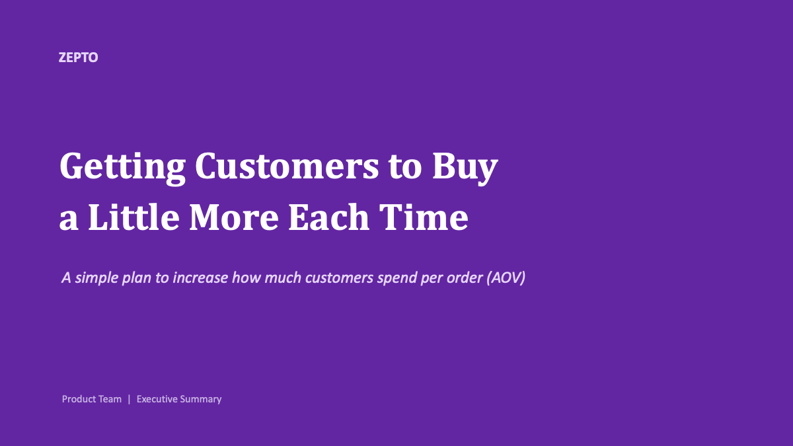

# Zepto: Getting Customers to Buy a Little More Each Time

**Growth strategy and prioritisation** · [← All case studies](../)

## Problem

Zepto's order count is growing, but average order value (AOV) is not keeping pace. Many customers place one- or two-item orders.

## Approach

- **Five shopper types**, from the "I ran out" shopper to the "browsing for something new" shopper. The first three make up roughly 8 in 10 orders, and their baskets are capped by habit, not budget.
- **Four blockers:** an in-and-out mindset, easy-to-ignore suggestions, one-tap reorder habit loops, and nothing to look forward to.
- **Three ideas** that build on what Zepto already does:
  1. **Build Your Bundle:** "you may also like" with a small discount. A quick win.
  2. **Recipe and Occasion Bundles:** turn one item into a whole meal. Also lays the groundwork for idea 3.
  3. **Cook More, Earn More:** reward cooking and healthy habits (meal missions, streaks), not spend. The differentiator.
- **Prioritisation** on reach, impact, confidence and effort, with an honest note on why the lowest-scoring idea is kept as a strategic bet.
- **Metrics:** AOV (primary), items per cart (supporting), order frequency (safety check) and customer satisfaction.

Written in plain language for a non-technical executive audience.

## Files

| File | Description |
|---|---|
| [aov-strategy-deck.pdf](aov-strategy-deck.pdf) | 10-slide executive presentation |
| [executive-summary.pdf](executive-summary.pdf) | Written executive summary |
