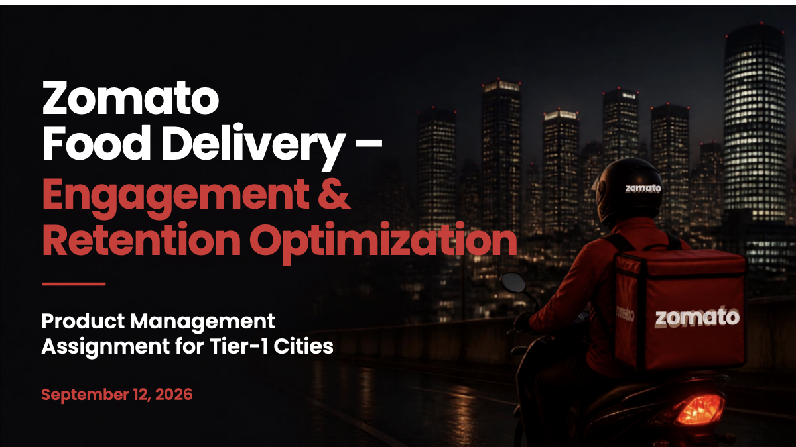

# Zomato: Engagement and Retention Optimisation

**Metrics and funnel analysis, Tier-1 cities** · [← All case studies](../)

## Problem

Food delivery in Tier-1 cities is growing fast and competition is intense. The goal: increase customer lifetime value and reduce churn across discovery, order, delivery and repeat.

## Approach

- **Personas:** urban professionals, families, budget-conscious students and food enthusiasts.
- **North Star:** Successful Repeat Delivered Orders per Monthly Active User.
- **Funnel analysis** from app open to repeat order. For each drop-off: a hypothesis, a proposed solution, a primary metric, input and output metrics, and guardrails. Solutions include a contextual home feed, intent-based ranking, smart menu highlights, auto-applied best offers, packaging for handling-sensitive items and occasion-based nudges.
- **Cohort analysis:** six retention segments (new, repeat, high-frequency, low-frequency, discount-driven, full-price), each with a retention challenge, hypothesis and metric set.
- **Metric linkage:** how solutions roll up to funnel conversion, retention and growth in monthly active ordering users.

## Files

| File | Description |
|---|---|
| [metrics-and-funnel-analysis.pdf](metrics-and-funnel-analysis.pdf) | 10-slide metrics presentation |
